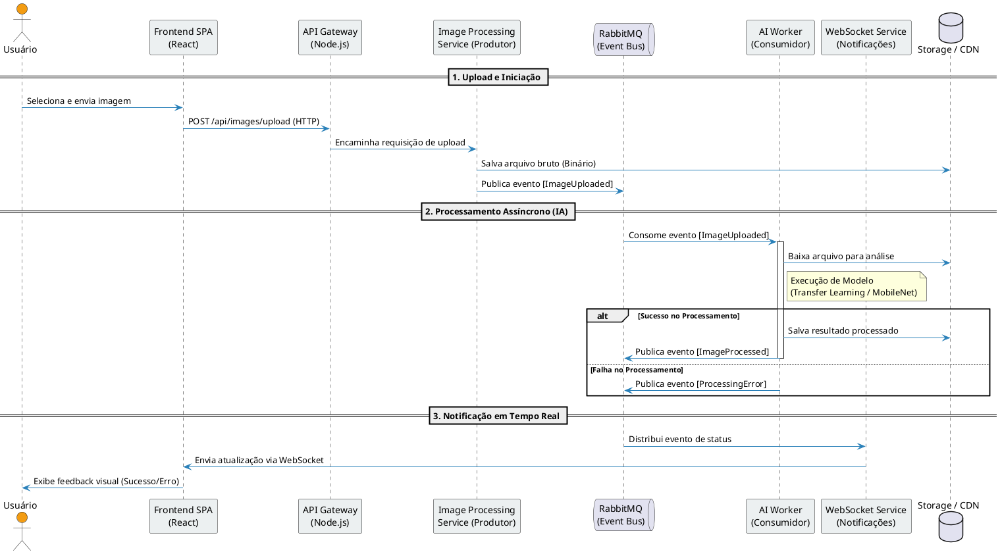

# ADR-001: Adoção de Arquitetura Orientada a Eventos para Processamento Assíncrono de Imagens

* **Status:** Aceito
* **Data:** Outubro de 2026
* **Autores:** Equipe de Engenharia PixPro


## 1. Contexto e Problema

O PixPro necessita de um fluxo robusto para o recebimento, processamento e aplicação de modelos de IA (via *Transfer Learning*) em imagens enviadas pelos usuários. 

Abordagens síncronas tradicionais (onde a API Gateway aguarda o término da inferência da IA para responder ao cliente) geram gargalos severos de desempenho, alto consumo de memória, riscos de *timeout* HTTP e acoplamento desnecessário entre a porta de entrada da aplicação e os modelos pesados de processamento.

Portanto, precisamos decidir como estruturar a arquitetura para desacoplar o upload de arquivos da execução computacional pesada, garantindo resiliência, escalabilidade e atualizações em tempo real para o usuário.


## 2. Decisão

Decidimos adotar uma **Arquitetura Orientada a Eventos (EDA)** baseada em mensageria assíncrona, utilizando o **RabbitMQ** como *Event Bus*, acoplado a um microsserviço de processamento de imagens e *workers* dedicados de IA. As atualizações de status serão comunicadas ao cliente via **WebSocket**.


## 3. Diagrama de Arquitetura (PlantUML)

O diagrama abaixo ilustra o fluxo detalhado desde o envio pelo usuário até a notificação de conclusão:



4. Descrição Formal e Papéis dos Componentes

API Gateway / Image Processing Service (Produtor):

> Papel: Ponto de entrada das requisições de upload. Valida a requisição, armazena o binário do arquivo de forma segura no Storage e atua como Publisher, disparando o evento inicial no Event Bus.

RabbitMQ (Event Bus):

> Papel: Broker de mensagens responsável por desacoplar o produtor dos consumidores. Garante a entrega confiável das tarefas através de filas persistentes e roteamento por topics.

AI Workers (Consumidores):

> Papel: Microsserviços assíduos que escutam as filas do broker. Extraem as mensagens, baixam os arquivos e aplicam os modelos de IA pré-treinados (Transfer Learning), publicando o resultado posterior.

WebSocket Service (Notificações):

> Papel: Manter conexões bidirecionais abertas com o Frontend para propagar o status da tarefa em tempo real, eliminando a necessidade de polling HTTP.

Storage / CDN:

> Papel: Repositório centralizado para persistência dos arquivos originais e dos ativos processados pela IA.

5. Especificação de Contratos de Eventos (Payloads JSON)

Para padronizar a comunicação assíncrona no Event Bus, definimos os seguintes contratos estruturados em formato JSON:

- A. Evento: ImageUploaded (Disparado pelo Produtor)

Emitido logo após o recebimento e salvamento do arquivo bruto, requisitando a execução do processamento.
```json
{
  "eventId": "f47ac10b-58cc-4372-a567-0e02b2c3d479",
  "eventType": "ImageUploaded",
  "timestamp": "2026-10-19T21:00:00.000Z",
  "data": {
    "imageId": "img_987654321",
    "userId": "usr_123456789",
    "filePath": "/storage/raw/usr_123456789/img_987654321.jpg",
    "originalName": "foto_perfil.jpg",
    "mimeType": "image/jpeg"
  }
}
```

- B. Evento: ImageProcessed (Disparado pelo Worker em Sucesso)

Emitido quando o modelo de IA conclui a inferência e o processamento do ativo com sucesso.
```json
{
  "eventId": "a1b2c3d4-e5f6-7890-abcd-ef1234567890",
  "eventType": "ImageProcessed",
  "timestamp": "2026-10-19T21:00:05.432Z",
  "data": {
    "imageId": "img_987654321",
    "userId": "usr_123456789",
    "processedFilePath": "/storage/processed/usr_123456789/img_987654321_out.jpg",
    "aiMetadata": {
      "modelUsed": "MobileNet-TransferLearning-v1",
      "confidence": 0.965,
      "tags": ["outdoor", "portrait", "high_resolution"]
    }
  }
}
```

- C. Evento: ProcessingError (Disparado pelo Worker em Falha)

Emitido caso ocorra algum erro durante o consumo da mensagem, corrupção de arquivo ou falha de inferência do modelo.
```json
{
  "eventId": "98765432-10ab-cdef-1234-567890abcdef",
  "eventType": "ProcessingError",
  "timestamp": "2026-10-19T21:00:03.111Z",
  "data": {
    "imageId": "img_987654321",
    "userId": "usr_123456789",
    "errorCode": "AI_INFERENCE_TIMEOUT",
    "errorMessage": "O tempo limite de execução do modelo de IA foi excedido.",
    "retryCount": 1
  }
}
```

6. Consequências

Positivas:

- Desacoplamento: A API Gateway responde imediatamente ao usuário, melhorando a experiência de navegação (User Experience).
- Resiliência: Se os workers de IA caírem, as mensagens ficam retidas com segurança nas filas duráveis do RabbitMQ sem perda de dados.
- Escalabilidade Horizontal: É possível subir múltiplas instâncias de workers de IA em paralelo conforme o volume de imagens enviadas aumenta.

Negativas / Desafios:

- Complexidade de Depuração: Rastrear erros em fluxos assíncronos exige um bom sistema de centralização de logs (Correlation IDs).
- Consistência Eventual: O cliente não recebe o resultado final instantaneamente no mesmo canal HTTP, dependendo do mecanismo de WebSocket.
