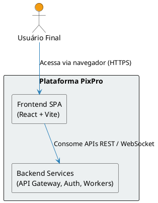
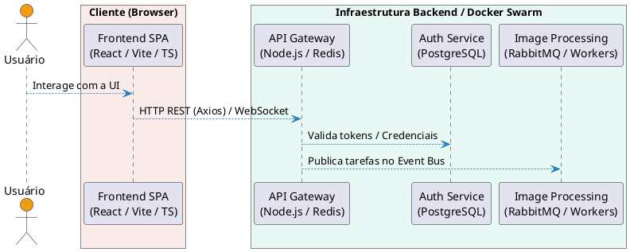
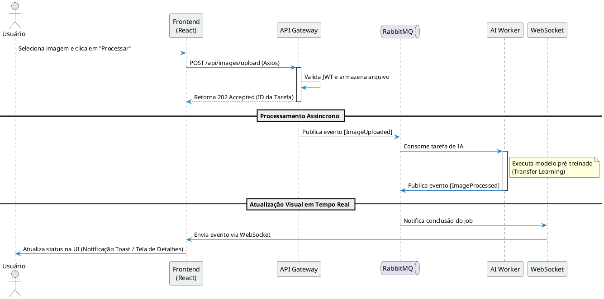

# ADR-002: Fundação da Arquitetura Frontend e Experiência do Usuário (PixPro)

* **Status:** Aceito
* **Data:** Outubro de 2026
* **Autores:** Equipe de Engenharia PixPro

---

## 1. Contexto e Problema

A plataforma PixPro exige uma interface de usuário (UI/UX) moderna, altamente responsiva e capaz de interagir de forma assíncrona com microsserviços de backend pesados (como processamento de imagens por IA, autenticação e mensageria). 

Precisamos definir a stack tecnológica e a fundação arquitetural do frontend (Single Page Application - SPA), estabelecendo padrões claros para gerenciamento de rotas, consumo de APIs via HTTP/WebSocket e o mapeamento das telas essenciais para o fluxo do usuário.

## 2. Decisão

Decidimos adotar **React** combinado com o **Vite** como empacotador de módulos (*bundler*), estruturando uma SPA modular. Para a comunicação com o backend, utilizaremos o **Axios** para requisições HTTP REST padronizadas e conexões **WebSocket** nativas para o recebimento de notificações em tempo real.

### Mapeamento de Funcionalidades do Frontend:
1. **Autenticação (Login / Register):** Telas de acesso e registro com validação de formulários e armazenamento seguro do token JWT de sessão.
2. **Dashboard / Histórico de Imagens:** Listagem centralizada do histórico de ativos enviados pelo usuário, exibindo miniaturas, status atual (*Pendente*, *Processado*, *Erro*) e metadados.
3. **Página de Detalhes da Imagem:** Visualização aprofundada de um ativo específico, permitindo acompanhar o resultado da IA, tags extraídas e opções de download do arquivo processado.
4. **Módulo de Processamento e Efeitos (IA):** Interface interativa para upload de imagens, seleção de modelos de IA / efeitos em tempo real e feedback visual assíncrono.

## 3. Arquitetura C4 (Níveis 1 e 2)

Os diagramas abaixo descrevem a arquitetura do sistema do ponto de vista do contexto e dos containers utilizando PlantUML.

### Nível 1: Diagrama de Contexto do Sistema (System Context)

### Nível 2: Diagrama de Containers (Container Diagram)

### 4. Diagrama de Sequência: Fluxo de Upload e Notificação em Tempo Real
O diagrama abaixo detalha a interação assíncrona entre o Frontend, o Gateway, o Broker e os Workers durante o envio e processamento de uma imagem.

### 5. Consequências e Vantagens Técnicas

- Alta Performance de Desenvolvimento: O uso do Vite garante tempos de carregamento instantâneos em ambiente de desenvolvimento (Hot Module Replacement ultrarrápido).

- Desacoplamento Visual: A arquitetura baseada em rotas e componentes no React permite que a equipe de frontend evolua as telas de histórico e detalhes de forma independente dos serviços de backend.

- Experiência Fluida (UX): O uso combinado de REST (Axios) para requisições síncronas e WebSocket para atualizações assíncronas evita o travamento da interface durante o processamento pesado de imagens por IA.