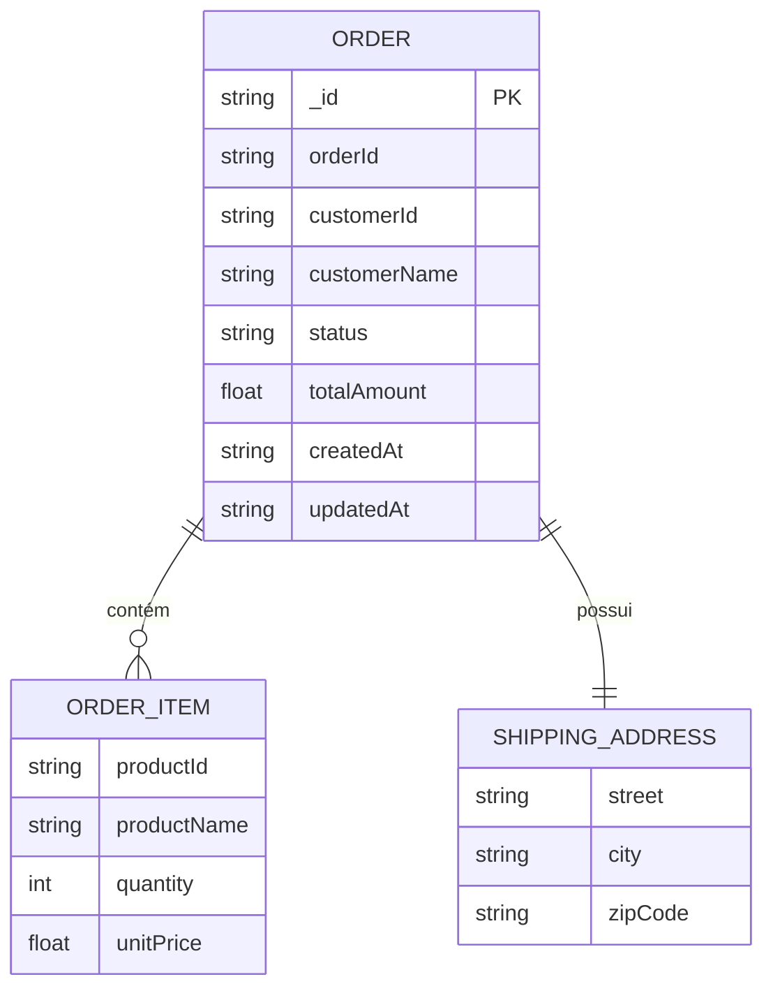

# ADR-007: CDN para o Armazenamento De Imagens

* **Status:** Aceito
* **Data:** Novembro de 2026
* **Autores:** Equipe de Engenharia PixPro

---

## Contexto

O sistema está sendo construído utilizando o padrão CQRS (Command Query Responsibility Segregation), onde as responsabilidades de escrita (Comandos) e leitura (Consultas) são isoladas em modelos distintos.

Nossa aplicação exige um modelo de leitura altamente otimizado para consultas de alta frequência, baixa latência e alta concorrência, suportando projeções desnormalizadas geradas a partir dos eventos publicados no Message Broker (ex: RabbitMQ/Kafka). Precisamos definir qual tecnologia utilizar para a base de dados de leitura do lado de Consultas (Query Database) e como estruturar o seu schema e otimizações.
Decisão

Decidimos adotar o PostgreSQL (com suporte a extensões e índices avançados) ou o MongoDB como banco de dados otimizado para o lado de leitura, dependendo da flexibilidade do schema estruturado. Para o escopo de alta performance em leituras complexas e flexibilidade de documentos desnormalizados, adotaremos o MongoDB (ou PostgreSQL com visões materializadas e tabelas projetadas, conforme a preferência da stack).

Abaixo, detalhamos a modelagem utilizando MongoDB como exemplo de banco de dados NoSQL orientado a documentos para leitura de alta frequência, pois ele permite armazenar projeções pré-computadas (Read Models) prontas para consumo direto pela API sem a necessidade de múltiplos JOINs pesados em tempo de execução.

## 1. Schema do Banco de Dados de Leitura (Read Model)

Considerando um cenário típico de e-commerce/gestão de pedidos (comumente utilizado nesses projetos de arquitetura), o schema de leitura desnormalizado para consultas rápidas de pedidos e detalhes do cliente/produtos é estruturado da seguinte forma:

```javascript
{
  "_textIndex": "pedido_search_idx",
  "collections": [
    {
      "name": "order_read_model",
      "schema": {
        "_id": "ObjectId",
        "orderId": "String (UUID/Unique)",
        "customerId": "String (Indexed)",
        "customerName": "String",
        "status": "String (Indexed - ex: 'PAID', 'SHIPPED')",
        "totalAmount": "Number",
        "items": [
          {
            "productId": "String",
            "productName": "String",
            "quantity": "Number",
            "unitPrice": "Number"
          }
        ],
        "shippingAddress": {
          "street": "String",
          "city": "String",
          "zipCode": "String"
        },
        "createdAt": "ISODate (Indexed)",
        "updatedAt": "ISODate"
      }
    }
  ]
}
```



## 2. Documentação para Otimização de Consultas de Alta Frequência

Para garantir que o banco de dados suporte milhares de requisições de leitura por segundo sem degradação de performance, implementamos a seguinte estratégia de otimização:

### A. Estratégia de Indexação

Como o volume de leitura é alto, criar os índices corretos evita varreduras completas na coleção (COLLSCAN).

Índice Composto para Filtros Frequentes:

```db.order_read_model.createIndex({ "customerId": 1, "createdAt": -1 }); ```

Justificativa: Otimiza listagens de pedidos de um cliente específico ordenados do mais recente para o mais antigo.

Índice para Status e Monitoramento:

```db.order_read_model.createIndex({ "status": 1, "createdAt": 1 }); ```

### B. Desnormalização Baseada em Eventos (Event-Driven Projections)

Como funciona: O módulo de escrita publica eventos (ex: OrderCreated, OrderShipped) no Message Broker.

O Consumidor de Leitura: Um microsserviço ou handler consome esses eventos e atualiza diretamente o documento consolidado em order_read_model. Dessa forma, nenhum JOIN ou agregação complexa é calculada em tempo de requisição do usuário, reduzindo o tempo de resposta (latência < 10ms).

### C. Estratégia de Cache (Redis) para Consultas Críticas

Para dados altamente acessados (como o dashboard principal ou catálogo estático):

- Implementa-se uma camada de cache distribuída com Redis na frente do banco de dados de leitura.
- Padrão Cache-Aside / Write-Through: Quando um evento de atualização chega via Message Broker, o cache correspondente é invalidado ou atualizado imediatamente.

### D. Particionamento e Sharding (Para Alta Escalabilidade)

Caso o volume de dados ultrapasse dezenas de milhões de registros, configuramos o Sharding no MongoDB utilizando orderId ou a hash de customerId como chave de fragmentação, distribuindo a carga de leitura e escrita horizontalmente entre múltiplos nós.

#### Consequências

Positivas:

- Isolamento completo entre transações de escrita (ACID pesado) e leitura otimizada (baixo acoplamento).
- Escalabilidade independente para o serviço de consultas.
- Resposta rápida em milissegundos para os clientes da API.

#### Negativas / Cuidados:

- Consistência eventual: Há um pequeno atraso (milissegundos/segundos) entre a gravação do comando e a atualização da projeção de leitura via Message Broker.