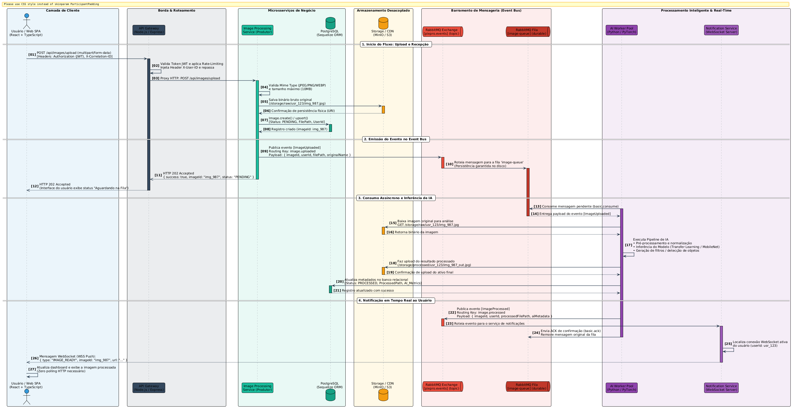
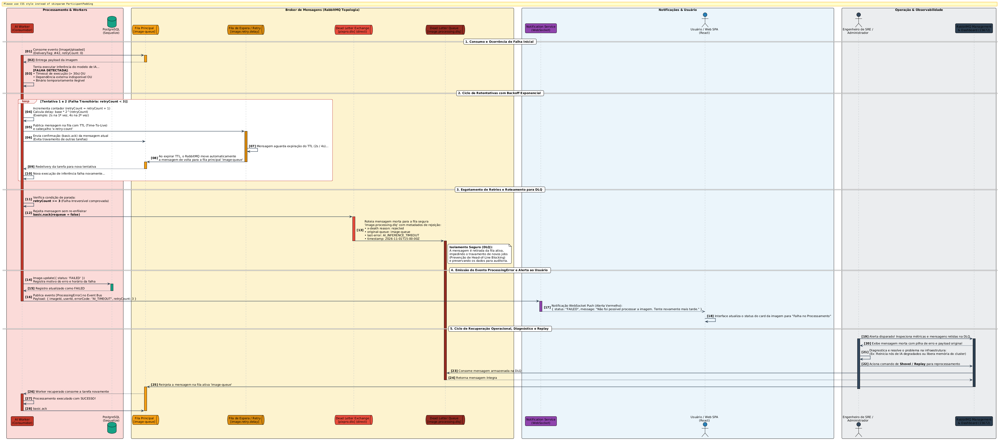

# PixPro — Documento de Design de Arquitetura Baseada em Eventos (EDA)

**Projeto Final PixPro — Capstone DS5**  
**Equipe:** Grupo 3  
**Status do Documento:** Aprovado / Versão 1.0  
**Data:** Novembro de 2026  
**Referência da Issue:** Issue 5.2 — *Arquitetura de Eventos, Diagramas e Documento de Design (Foco: Visualização)*

---

## 1. Introdução e Contexto do Problema

O **PixPro** é uma plataforma inteligente e distribuída para processamento de imagens, focada na aplicação de modelos avançados de Inteligência Artificial (Transfer Learning, melhoria estética e detecção de objetos). 

Nas abordagens arquiteturais tradicionais síncronas (onde o cliente mantém uma conexão HTTP aberta aguardando o término de uma inferência pesada de IA), o sistema sofre com:
* **Gargalos severos de latência e concorrência:** Conexões HTTP presas por dezenas de segundos reduzem a disponibilidade do API Gateway.
* **Risco crítico de *Timeouts*:** Quedas de rede transitórias causam falhas falsas-positivas de processamento.
* **Acoplamento rígido:** A indisponibilidade momentânea do serviço de inferência derruba o endpoint de upload.

Para resolver essas vulnerabilidades, adotou-se uma **Arquitetura Orientada a Eventos (Event-Driven Architecture - EDA)** fundamentada em mensageria assíncrona com **RabbitMQ**, armazenamento desacoplado e notificações bidirecionais via **WebSockets**.

---

## 2. Topologia do Barramento de Mensageria (RabbitMQ)

A topologia do broker foi projetada para garantir desacoplamento total entre produtores e consumidores:

| Elemento | Nome / Identificador | Tipo | Propriedades | Papel |
| :--- | :--- | :---: | :---: | :--- |
| **Exchange Principal** | `pixpro.events` | `topic` | `durable: true` | Ponto central de entrada do Event Bus para publicação de eventos de domínio. |
| **Fila Principal** | `image-queue` | `classic` | `durable: true` | Fila onde os eventos `ImageUploaded` aguardam consumo pelos workers de IA. |
| **Fila de Retry** | `image.retry.delay` | `classic` | `durable: true`, TTL | Fila com retenção temporária para execução de retries com backoff. |
| **Dead Letter Exchange**| `pixpro.dlx` | `direct`| `durable: true` | Roteador exclusivo para mensagens rejeitadas definitivamente. |
| **Dead Letter Queue** | `image.processing.dlq`| `classic` | `durable: true` | Fila morta para isolamento de mensagens com falha e auditoria operacional. |

---

## 3. Especificação Formal dos Contratos de Eventos

Padronizados em formato JSON estruturado com cabeçalhos de auditoria e rastreabilidade:

### 3.1 Evento `ImageUploaded` (Disparado pelo Produtor)
Publicado pelo `image-processing-service` logo após validar o arquivo físico e persistir os metadados no banco de dados com status `PENDING`:
```json
{
  "eventId": "f47ac10b-58cc-4372-a567-0e02b2c3d479",
  "eventType": "ImageUploaded",
  "timestamp": "2026-11-01T15:00:00.000Z",
  "data": {
    "imageId": "img_1792624271045_50f91595",
    "userId": "usr_123456789",
    "filePath": "/storage/raw/usr_123456789/img_1792624271045_50f91595.jpg",
    "originalName": "foto_perfil.jpg",
    "mimeType": "image/jpeg"
  }
}
```

### 3.2 Evento `ImageProcessed` (Disparado pelo Worker em Sucesso)
Publicado pelo worker de IA após o término da inferência e gravação do ativo processado:
```json
{
  "eventId": "a1b2c3d4-e5f6-7890-abcd-ef1234567890",
  "eventType": "ImageProcessed",
  "timestamp": "2026-11-01T15:00:06.432Z",
  "data": {
    "imageId": "img_1792624271045_50f91595",
    "userId": "usr_123456789",
    "processedFilePath": "/storage/processed/usr_123456789/img_1792624271045_50f91595_out.jpg",
    "aiMetadata": {
      "modelUsed": "MobileNet-TransferLearning-v1",
      "confidence": 0.965,
      "processingTimeMs": 1420,
      "tags": ["portrait", "outdoor", "enhanced"]
    }
  }
}
```

### 3.3 Evento `ProcessingError` (Disparado pelo Worker em Falha Irreversível)
Publicado quando todas as tentativas de reprocessamento forem esgotadas antes de despachar a mensagem para a DLQ:
```json
{
  "eventId": "98765432-10ab-cdef-1234-567890abcdef",
  "eventType": "ProcessingError",
  "timestamp": "2026-11-01T15:00:15.111Z",
  "data": {
    "imageId": "img_1792624271045_50f91595",
    "userId": "usr_123456789",
    "errorCode": "AI_INFERENCE_TIMEOUT",
    "errorMessage": "O tempo limite de execução do modelo de IA foi excedido após 3 tentativas.",
    "retryCount": 3
  }
}
```

---

## 4. Diagrama 1.1: Fluxo Normal de Eventos e Requisições

### 4.1 Representação Visual Integrada



### 4.2 Análise do Fluxo Normal
1. **Recepção e Segurança (API Gateway):** O cliente envia a imagem via requisição `multipart/form-data`. O API Gateway autentica o token JWT, valida permissões, aplica controle de vazão (*Rate Limiting*) e repassa ao serviço de processamento injetando o Correlation ID.
2. **Desacoplamento Imediato:** O `image-processing-service` valida o arquivo (extensões e limite de 10MB), salva o binário no storage desacoplado e grava um registro no PostgreSQL via **Sequelize** com status `PENDING`.
3. **Aceite Assíncrono (HTTP 202):** A mensagem do evento `ImageUploaded` é entregue à exchange `pixpro.events` (com flag `persistent: true`) e roteada para a fila `image-queue`. A API responde de imediato `HTTP 202 Accepted` ao cliente, liberando o navegador.
4. **Execução de IA em Background:** Um nó do pool de workers consome a mensagem da fila, transfere o arquivo para sua memória de trabalho, aplica os modelos de rede neural e persiste o resultado processado.
5. **Notificação Push em Tempo Real:** O worker publica `ImageProcessed`. O `Notification Service` recebe o evento via RabbitMQ e encaminha um push através da conexão WebSocket aberta com o usuário, atualizando o painel visual sem nenhum polling HTTP repetitivo.

---

## 5. Diagrama 1.2: Ciclo Completo de Tratamento de Erros, Resiliência e DLQ

### 5.1 Representação Visual Integrada



### 5.2 Análise dos Mecanismos de Resiliência
1. **Detecção da Falha e Isolamento:** Falhas transitórias (como lentidão de storage ou indisponibilidade momentânea de nós de processamento) são capturadas pelo bloco de tratamento do worker.
2. **Backoff Exponencial:** Para não sobrecarregar o sistema com retries imediatos repetitivos, a mensagem é direcionada para uma fila de espera temporizada cujo delay cresce exponencialmente:
   $$\text{Delay}(n) = \text{base} \times 2^{n} \quad (n = \text{tentativa})$$
3. **Prevenção de Head-of-Line Blocking via DLQ:** Caso uma mensagem contenha dados corrompidos (*poison pill*), re-enfileirá-la infinitamente travaria a capacidade de processamento de novos arquivos dos usuários. Atingido o limite de 3 tentativas, o worker emite `basic.nack(requeue = false)`. O RabbitMQ encaminha a mensagem para a **Dead Letter Exchange (`pixpro.dlx`)** e a armazena na **Dead Letter Queue (`image.processing.dlq`)**.
4. **Feedback de Falha:** O evento `ProcessingError` é emitido, atualizando a base relacional com status `FAILED` e enviando um alerta vermelho via WebSocket para o usuário.
5. **Reconciliação Administrativa:** A equipe de suporte inspeciona o RabbitMQ Dashboard (`http://localhost:15672`), analisa os cabeçalhos `x-death` e, após a resolução técnica do problema, aciona o recurso de **Shovel / Replay**, movendo as mensagens da DLQ de volta para a fila `image-queue` para reprocessamento com taxa zero de perda de dados.

---

## 6. Propostas Técnicas de Evolução Arquitetural

Como contribuição para as próximas semanas do projeto Capstone, propõem-se as seguintes melhorias:

1. **Transactional Outbox Pattern:**
   * *Problema mitigado:* Eliminar o risco de inconsistência (*Dual-Write*) caso o banco salve o registro mas a conexão com o RabbitMQ caia no milissegundo subsequente.
   * *Solução:* Salvar o evento na tabela `outbox_messages` dentro da mesma transação ACID do Sequelize e utilizar um daemon de relayer para publicar no broker.
2. **Controle de Idempotência com Chave Distribuída (Redis):**
   * *Problema mitigado:* Emissão de mensagens duplicadas causadas por reentregas de rede.
   * *Solução:* Gravação de chave atômica `SETNX image:job:<imageId> 1 EX 86400` antes de iniciar a inferência.
3. **Métricas de Observabilidade (Prometheus + Grafana):**
   * Exportação contínua de métricas de mensageria: `rabbitmq_queue_messages_ready`, taxa de mensagens roteadas para a DLQ e tempo médio de retenção.

---

## 7. Conclusão

A arquitetura orientada a eventos implementada e documentada nesta entrega atende integralmente aos requisitos de modularidade, alta disponibilidade e desacoplamento do projeto PixPro. Os diagramas e especificações de contratos fornecem a base técnica necessária para a homologação das próximas etapas de testes distribuídos e integração contínua do sistema.
