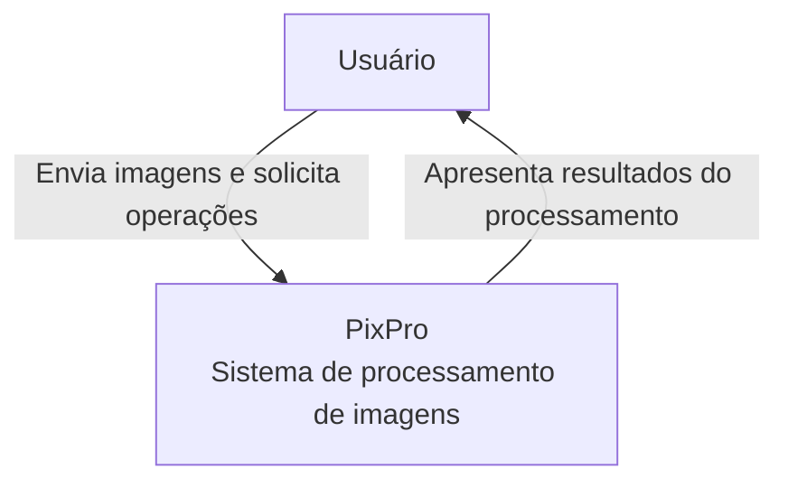

# C4 N1 — Diagrama de Contexto do PixPro

## Objetivo

Este diagrama apresenta uma visão geral do PixPro, identificando seus usuários e o propósito principal do sistema.

## Diagrama

## Descrição

O PixPro é um projeto que tem como objetivo desenvolver um sistema com funcionalidades de melhoria de imagens, detecção de objetos e aplicação de efeitos em tempo real.

O sistema permitirá que os usuários utilizem essas funcionalidades e visualizem os resultados.

## Observações

Este diagrama representa uma visão inicial do projeto. As tecnologias, integrações externas e demais decisões arquitetônicas serão definidas posteriormente pelo grupo.
