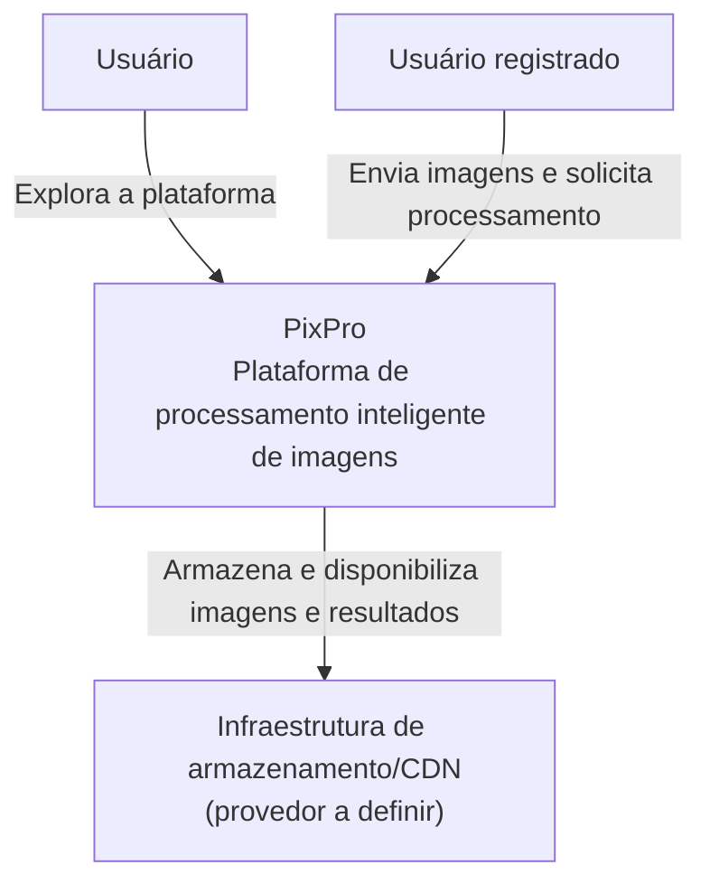

# C4 N1 — Diagrama de Contexto do PixPro

## Objetivo

Apresentar o PixPro, seus usuários e as principais interações com a plataforma.

## Diagrama

## Descrição

O PixPro é uma plataforma de processamento inteligente de imagens. Seu objetivo é permitir o envio de imagens, a solicitação de operações de processamento e a consulta dos resultados.

As funcionalidades previstas incluem melhoria de imagens, detecção de objetos, aplicação de efeitos artísticos e acompanhamento do processamento.

A plataforma também prevê gerenciamento de projetos, histórico, download, compartilhamento e notificações em tempo real.

## Observações

Este diagrama apresenta o contexto geral do sistema. Os componentes internos do backend são detalhados no C4 N2.
O provedor de armazenamento/CDN ainda será definido pela equipe.
