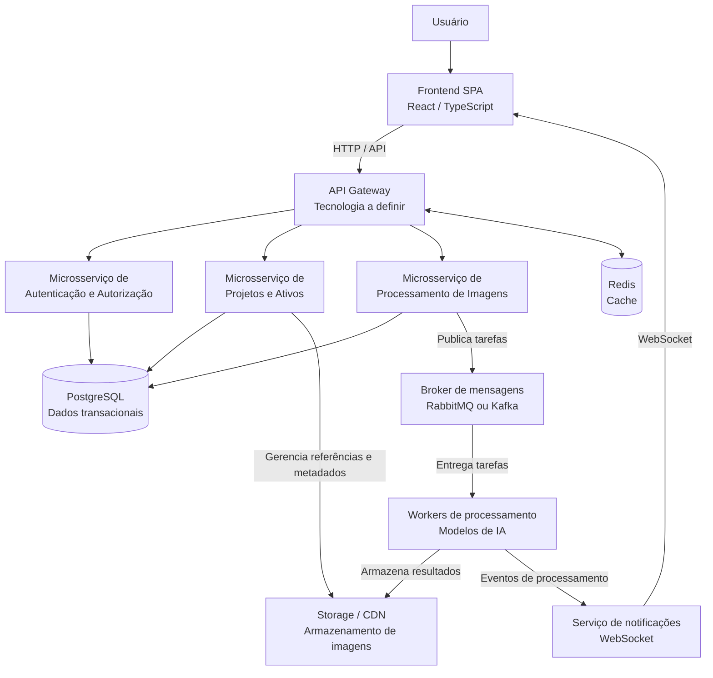

# C4 N2 — Diagrama de Contêineres do PixPro

## Objetivo

Representar os principais componentes da arquitetura backend do PixPro, suas responsabilidades e as relações entre eles, conforme a proposta arquitetônica do grupo.

## Diagrama

## Descrição dos componentes

* **Frontend SPA:** interface utilizada pelos usuários para acessar a plataforma.
* **API Gateway:** ponto de entrada do backend, responsável por encaminhar as requisições aos serviços apropriados.
* **Autenticação e Autorização:** gerencia a identidade e o controle de acesso dos usuários.
* **Projetos e Ativos:** gerencia projetos, imagens, metadados e histórico.
* **Processamento de Imagens:** coordena as solicitações e o acompanhamento das tarefas de processamento.
* **Broker de mensagens:** permite a comunicação assíncrona entre o serviço de processamento e os workers.
* **Workers de processamento:** executam as operações de processamento de imagens e os modelos de IA.
* **Notificações WebSocket:** comunica atualizações do processamento ao frontend.
* **PostgreSQL:** armazena os dados transacionais dos domínios.
* **Redis:** oferece suporte ao cache.
* **Storage/CDN:** armazena e distribui os arquivos de imagem e os resultados.

## Fluxo principal

1. O usuário envia uma solicitação pelo frontend.
2. O API Gateway encaminha a solicitação ao microsserviço responsável.
3. Quando há processamento de imagem, o serviço publica uma tarefa no broker.
4. Um worker consome a tarefa e executa o processamento.
5. O resultado é armazenado na infraestrutura de armazenamento.
6. Os eventos de processamento são encaminhados ao serviço de notificações.
7. O frontend recebe atualizações por WebSocket.

## Decisões pendentes

* Escolha definitiva da tecnologia do API Gateway.
* Escolha entre RabbitMQ e Kafka.
* Definição da organização física dos bancos de dados por microsserviço.
* Definição do provedor de Storage/CDN.
* Detalhamento dos contratos de API, eventos e notificações.

Os diagramas representam uma proposta arquitetônica inicial e devem ser revisados conforme as decisões do grupo evoluírem.
