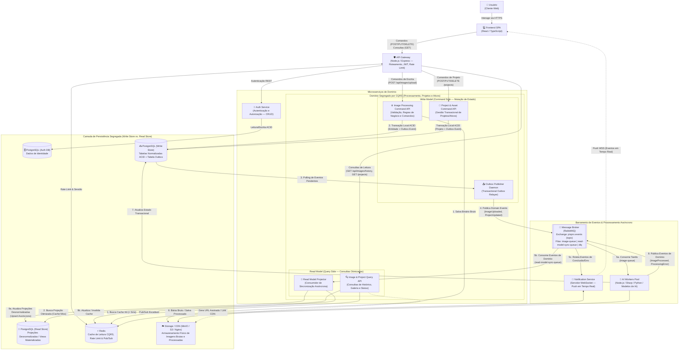

# C4 N2 — Diagrama de Contêineres do PixPro (Arquitetura CQRS e EDA)

## 1. Objetivo

Representar os principais contêineres da arquitetura backend do **PixPro**, evidenciando a segregação de responsabilidades entre o **Modelo de Comandos (Write Model)** e o **Modelo de Consultas (Read Model)** conforme o padrão **CQRS (Command Query Responsibility Segregation)** integrado à **Arquitetura Orientada a Eventos (EDA)** via **RabbitMQ**.

---

## 2. Diagrama C4 N2 (Segregação Write Model vs. Read Model)

---

## 3. Identificação dos Microsserviços e Aplicação do CQRS

Nem todos os microsserviços exigem a complexidade do padrão CQRS. A análise de domínio e perfil de carga definiu a seguinte divisão:

| Microsserviço | Padrão Adotado | Justificativa Arquitetural |
| :--- | :---: | :--- |
| **Image Processing Service** | **CQRS + EDA** | **Alta assimetria entre leitura e escrita:** A escrita envolve upload multipart, validação estrita, gravação transacional com Outbox e disparo de inferência pesada em background. Já a leitura exige listagens rápidas de status, métricas de IA e histórico paginado. |
| **Project & Asset Service** | **CQRS + EDA** | **Consultas complexas vs. mutações pontuais:** Mutações (criar projeto, vincular ativo) exigem consistência forte ACID, enquanto consultas de galerias, filtros por tags/modelos de IA, busca de histórico (`CU08`) e URLs de CDN exigem projeções desnormalizadas e cache em memória (Redis). |
| **Auth Service** | **CRUD Transacional** | **Baixa complexidade de projeção:** Operações de login, cadastro e validação de credenciais exigem consistência imediata na mesma estrutura relacional (`users`), sem ganho real ao separar modelos de leitura e escrita. |
| **Notification Service** | **Stateless Event Consumer** | Atua exclusivamente como ponte reativa entre os eventos do RabbitMQ e os clientes conectados via WebSocket (WSS), sem manter banco de dados de domínio próprio. |

---

## 4. Mapeamento de Comandos, Eventos de Domínio e Consultas

### 4.1 Modelo de Comandos (Write Model — Mutação de Estado)
* `UploadImageCommand` (`POST /api/images/upload`): Recebe o arquivo, armazena no Storage/CDN, grava registro transacional com status `PENDING` e registra evento na tabela `outbox_messages`.
* `SubmitProcessingJobCommand` (`POST /api/images/:id/process`): Define os parâmetros do pipeline de IA (filtros, redimensionamento, detecção, modelo Sharp/MobileNet) e agenda a execução.
* `ReprocessImageCommand` (`POST /api/images/:id/reprocess`): Reexecuta um trabalho anterior a partir do histórico.
* `CreateProjectCommand` / `ArchiveAssetCommand`: Comandos transacionais de organização de pastas e ativos do usuário.

### 4.2 Eventos de Domínio (Domain Events — Publicados no RabbitMQ)
Todos os eventos são publicados na exchange `pixpro.events` (`topic`, `durable: true`) e roteados simultaneamente para os **AI Workers**, para o **Read Model Projector** e para o **Notification Service**:

| Evento de Domínio | Routing Key | Emissor (Produtor) | Consumidores | Impacto no Read Model (Projeção Assíncrona) |
| :--- | :--- | :--- | :--- | :--- |
| **`ImageUploaded`** | `image.uploaded` | `Image Processing Command API` (via Outbox) | `AI Worker Pool`, `Read Model Projector` | Insere novo registro na visão `image_history_view` com status `PENDING` e invalida cache de listagem do usuário no Redis. |
| **`ProcessingStarted`** | `image.processing.started` | `AI Worker Pool` | `Read Model Projector`, `Notification Service` | Atualiza status na projeção de leitura para `PROCESSING` e registra timestamp de início. |
| **`ImageProcessed`** | `image.processed` | `AI Worker Pool` | `Read Model Projector`, `Notification Service` | Atualiza a projeção desnormalizada com `status = PROCESSED`, URL da CDN, tags geradas, confiança do modelo e tempo de inferência (`processingTimeMs`); atualiza cache no Redis. |
| **`ProcessingError`** | `image.processing.error` | `AI Worker Pool` | `Read Model Projector`, `Notification Service`, `DLQ` | Marca a projeção de leitura como `FAILED`, grava código/mensagem do erro e número de tentativas (`retryCount`). |
| **`ProjectUpdated`** | `project.updated` | `Project Command API` | `Read Model Projector` | Atualiza contadores de ativos, nome do projeto e listagens agregadas na visão de leitura. |

### 4.3 Modelo de Consultas (Read Model — Leitura Otimizada)
* `GetUserImageHistoryQuery` (`GET /api/images/history?page=1&status=PROCESSED`): Consulta diretamente a projeção desnormalizada (`image_history_view`) ou o cache no Redis, retornando em milissegundos sem realizar `JOINs` pesados nem bloquear as tabelas transacionais de escrita.
* `GetImageStatusQuery` (`GET /api/images/:id`): Retorna o estado consolidado do processamento, URL assinada do CDN e metadados de IA.
* `GetProjectGalleryQuery` (`GET /api/projects/:id/gallery`): Retorna a galeria consolidada de imagens originais e processadas de um projeto.

---

## 5. Fluxo Detalhado de Sincronização Assíncrona (Write Model ➔ Broker ➔ Read Model)

1. **Execução do Comando (Write Side):** O usuário envia um comando (`POST /api/images/upload`). O `Image Processing Command API` valida as regras de negócio, persiste o binário no Storage/CDN e executa uma transação ACID no **PostgreSQL Write Store**, salvando a entidade normalizada e o evento `ImageUploaded` na tabela `outbox_messages`.
2. **Publicação no Message Broker:** O `Outbox Publisher` lê os registros pendentes e publica o evento na exchange `pixpro.events` do **RabbitMQ**. A API retorna imediatamente `HTTP 202 Accepted`.
3. **Fan-out por Tópicos (Desacoplamento):** O RabbitMQ distribui cópias da mensagem para filas independentes:
   * `image-queue`: Consumida pelo **AI Worker Pool** para executar a inferência computacional.
   * `read-model-sync-queue`: Consumida pelo **Read Model Projector** para atualizar a base de leitura.
4. **Atualização Assíncrona do Read Model (Consistência Eventual):**
   * O **Read Model Projector** consome o evento `ImageUploaded` (e posteriormente `ImageProcessed` ou `ProcessingError`), aplica uma operação idempotente de `UPSERT` na tabela desnormalizada do **PostgreSQL Read Store** (`image_history_view`) e atualiza/invalida a chave correspondente no **Redis** (`cache:user:{userId}:history`).
5. **Notificação e Leitura Rápida:** O **Notification Service** envia o push via WebSocket para o Frontend SPA. Quando o usuário consulta seu painel ou histórico (`GET /api/images/history`), a **Query API** lê diretamente do **Redis / Read Store**, garantindo baixa latência e isolamento total de carga em relação aos workers de IA.
