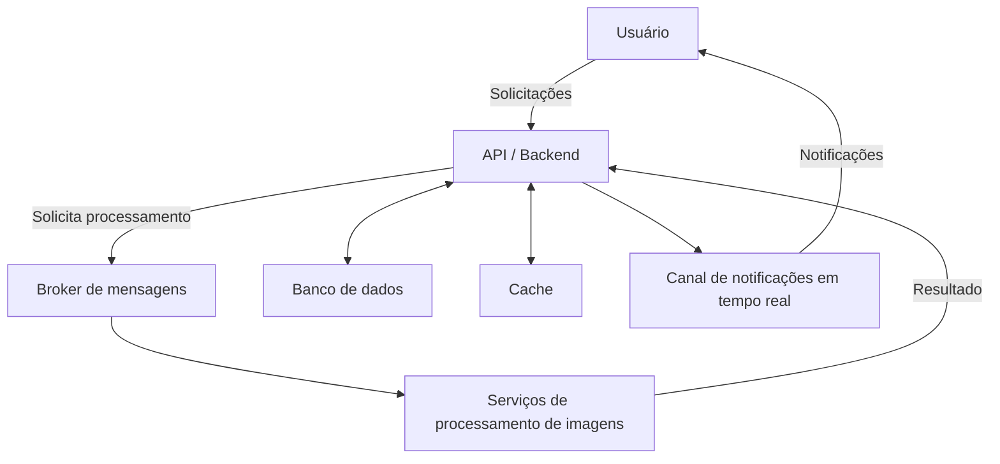

# C4 N2 — Diagrama de Contêineres do PixPro

## Objetivo

Apresentar uma visão inicial dos principais componentes internos do PixPro e como eles se relacionam.

## Diagrama

## Descrição dos componentes

* **API / Backend:** recebe as solicitações do usuário e coordena as operações do sistema.
* **Broker de mensagens:** permite organizar e distribuir tarefas de processamento.
* **Serviços de processamento de imagens:** representam as funcionalidades de melhoria de imagens, detecção de objetos e aplicação de efeitos.
* **Banco de dados:** armazena as informações que o sistema precisar persistir.
* **Cache:** permite armazenar temporariamente dados para acesso rápido.
* **Canal de notificações em tempo real:** permite informar o usuário sobre atualizações do processamento.

## Decisões pendentes

As tecnologias, a divisão definitiva dos microsserviços, o armazenamento das imagens e os protocolos de comunicação serão definidos pelo grupo durante o planejamento da arquitetura.

Este diagrama é uma proposta inicial e poderá ser atualizado após a definição da arquitetura de backend.
