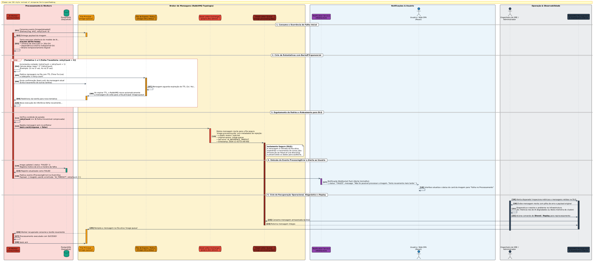
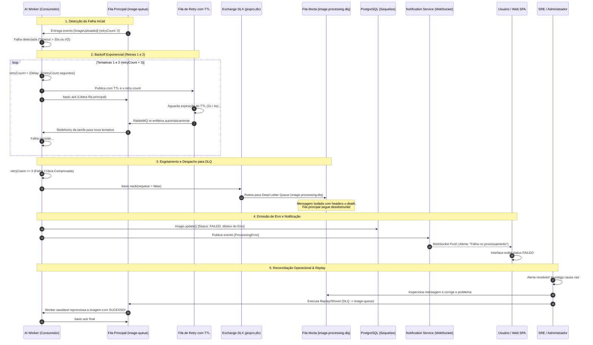

# Diagrama 1.2: Ciclo Completo de Tratamento de Erros, Resiliência e DLQ

## 1. Objetivo

Este diagrama modela o ciclo completo de **tolerância a falhas, retentativas com backoff exponencial, isolamento em Dead Letter Queue (DLQ) e reconciliação operacional** do **PixPro**. Ele descreve como a plataforma detecta falhas (transitórias ou permanentes), isola mensagens corrompidas para evitar travamento da fila principal (*head-of-line blocking*), notifica o usuário via WebSocket e permite a recuperação administrativa sem perda de dados.

---

## 2. Diagrama Visual em Alta Resolução

> **Nota:** Arquivo vetorial de alta definição disponível em [`ciclo-tratamento-erros-dlq.svg`](ciclo-tratamento-erros-dlq.svg) e código fonte em [`ciclo-tratamento-erros-dlq.puml`](ciclo-tratamento-erros-dlq.puml).

---

## 3. Diagrama em Sintaxe Mermaid (Renderização Nativa)

---

## 4. Pilares de Resiliência Modelados

### A. Backoff Exponencial (Exponential Backoff)
Para falhas transitórias (como instabilidade momentânea de rede com o Storage ou contenção temporária de GPU), o sistema aplica retentativas automáticas espaçadas temporalmente:
$$\text{Delay} = \text{base} \times 2^{\text{retryCount}}$$
* **1ª tentativa:** 2 segundos
* **2ª tentativa:** 4 segundos
* **3ª tentativa:** Esgotamento de limite de retentativas.

### B. Prevenção de Bloqueio em Fila (*Head-of-Line Blocking*)
Se um arquivo corrompido for re-enfileirado infinitamente na frente da fila, todo o cluster de IA ficará travado processando o mesmo arquivo inválido. O envio para a **Dead Letter Queue (`image.processing.dlq`)** após 3 tentativas remove a mensagem tóxica do fluxo ativo sem descartá-la.

### C. Rastreabilidade com Metadados `x-death`
Ao ser roteada para a DLQ, a mensagem recebe do broker as seguintes informações de auditoria:
* `reason`: motivo da rejeição (`rejected`).
* `queue`: fila de origem (`image-queue`).
* `count`: total de vezes que a mensagem falhou antes de ser morta.
* `time`: timestamp exato da falha irreversível.

### D. Reconciliação e Operação de Replay (Shovel)
A DLQ é persistente e segura. Quando os engenheiros de SRE corrigem a causa raiz (ex: ampliação de memória dos containers ou restabelecimento do serviço de armazenamento), o plugin **RabbitMQ Shovel** ou uma CLI de automação drena a DLQ de volta para a fila `image-queue`, recuperando o processamento sem que o usuário precise fazer novo upload.
