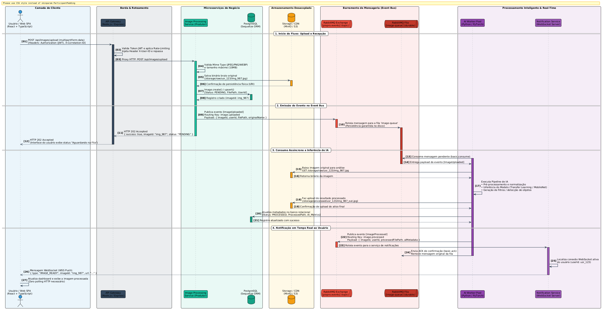
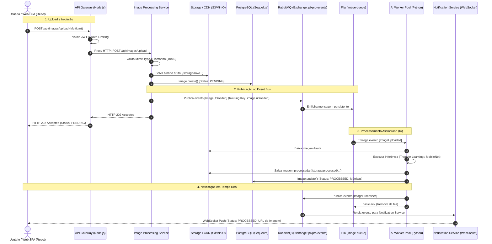

# Diagrama 1.1: Fluxo Normal de Eventos e Requisições no Ecossistema

## 1. Objetivo

Este diagrama modela o **caminho feliz (Happy Path)** da arquitetura orientada a eventos do **PixPro**. Ele descreve como uma imagem enviada pelo usuário é recepcionada, validada, persistida em metadados, processada assincronamente por modelos de inteligência artificial através do barramento **RabbitMQ**, e finalmente notificada ao cliente em tempo real via **WebSockets**.

---

## 2. Diagrama Visual em Alta Resolução

> **Nota:** Arquivo vetorial de alta definição disponível em [`fluxo-eventos-normal.svg`](fluxo-eventos-normal.svg) e código fonte em [`fluxo-eventos-normal.puml`](fluxo-eventos-normal.puml).

---

## 3. Diagrama em Sintaxe Mermaid (Renderização Nativa)

---

## 4. Detalhamento Técnico das Etapas

1. **Recepção e Segurança (API Gateway):**
   * O cliente envia a requisição autenticada via token JWT no cabeçalho `Authorization`.
   * O API Gateway valida a assinatura do JWT, aplica rate-limiting com Redis e encaminha a requisição via proxy para o `image-processing-service` preservando o `X-Correlation-ID`.

2. **Ingestão e Desacoplamento (Image Processing Service):**
   * O serviço valida se o arquivo possui um tipo MIME permitido (`image/jpeg`, `image/png`, `image/webp`) e tamanho inferior a 10MB.
   * O binário é gravado no storage e os metadados são registrados no PostgreSQL via Sequelize com status `PENDING`.
   * O serviço publica o evento `ImageUploaded` na exchange `pixpro.events` com routing key `image.uploaded`.
   * O cliente recebe imediatamente a resposta **HTTP 202 Accepted**, garantindo tempo de resposta na casa de milissegundos.

3. **Inferência Computacional (AI Workers):**
   * Os workers de IA consomem tarefas concorrentemente da fila durável `image-queue`.
   * O modelo de IA executa a inferência em background sem concorrer com os servidores web.
   * O resultado gerado é salvo na pasta de ativos processados e os metadados são atualizados no banco de dados para `PROCESSED`.

4. **Notificação Push em Tempo Real (WebSocket Service):**
   * O worker publica o evento `ImageProcessed` no barramento.
   * O serviço de WebSocket distribui o evento instantaneamente para o cliente correto, atualizando a interface gráfica do usuário sem necessidade de recarregar a página (*Zero HTTP Polling*).
