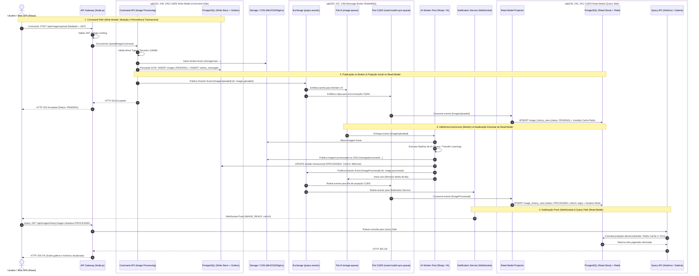

# Diagrama 1.1: Fluxo de Eventos e Arquitetura CQRS (Write Model vs. Read Model)

## 1. Objetivo

Este diagrama modela o **fluxo ponta a ponta da arquitetura orientada a eventos (EDA) combinada com CQRS (Command Query Responsibility Segregation)** do **PixPro**. Ele evidencia:
1. **Command Path (Write Model):** Como comandos de mutação (`UploadImageCommand`) são validados, persistidos no **Write Store** (PostgreSQL transacional + tabela Outbox) e transformados em eventos de domínio publicados no **RabbitMQ**.
2. **Processamento e Sincronização Assíncrona:** Como o barramento distribui eventos simultaneamente para o **AI Worker Pool** (inferência computacional) e para o **Read Model Projector** (atualização assíncrona das projeções desnormalizadas e cache Redis).
3. **Query Path (Read Model) e Notificações WebSocket:** Como o cliente recebe o push em tempo real e realiza consultas de alta performance (`GetUserImageHistoryQuery`) diretamente no **Read Store / Redis**, sem onerar o banco de escrita.

---

## 2. Diagrama Visual em Alta Resolução

> **Nota:** Arquivo vetorial de alta definição disponível em [`fluxo-eventos-normal.svg`](fluxo-eventos-normal.svg) e código fonte PlantUML em [`fluxo-eventos-normal.puml`](fluxo-eventos-normal.puml).

---

## 3. Diagrama em Sintaxe Mermaid (Renderização Nativa)

---

## 4. Detalhamento Técnico das Etapas (CQRS + EDA)

1. **Command Path — Recepção e Escrita Transacional (Write Model):**
   * O cliente envia o comando `POST /api/images/upload` autenticado via JWT.
   * O **Command API** (`image-processing-service`) valida o arquivo (`image/jpeg`, `image/png`, `image/webp` até 10MB), persiste o binário no Storage/CDN e realiza uma transação ACID no **Write Store** gravando o estado normalizado (`PENDING`) junto ao registro na tabela `outbox_messages`.
   * O evento de domínio `ImageUploaded` é publicado na exchange `pixpro.events` (`topic`) e o cliente recebe `HTTP 202 Accepted` imediatamente.

2. **Roteamento Fan-out e Projeção Inicial (Broker ➔ Read Model):**
   * A exchange `pixpro.events` distribui o evento `ImageUploaded` para duas filas distintas: `image-queue` (processamento de IA) e `read-model-sync-queue` (sincronização CQRS).
   * O **Read Model Projector** consome da `read-model-sync-queue` e cria o registro inicial na visão desnormalizada `image_history_view` do **Read Store**, garantindo que consultas imediatas ao histórico já reflitam o item como `PENDING`.

3. **Inferência Computacional e Sincronização de Conclusão:**
   * O **AI Worker Pool** consome da `image-queue`, aplica as transformações e modelos de IA, faz o upload do ativo final para o Storage/CDN e emite o evento de domínio `ImageProcessed` (ou `ProcessingError` em caso de falha).
   * O **Read Model Projector** consome `ImageProcessed` de forma assíncrona e executa um `UPSERT` idempotente na tabela de leitura desnormalizada (`image_history_view`), preenchendo a URL da CDN, tags e tempo de inferência, além de atualizar o cache no **Redis**.

4. **Notificação em Tempo Real e Query Path (Read Model):**
   * Paralelamente à atualização do Read Model, o **Notification Service** envia um push via WebSocket (`IMAGE_READY`) ao navegador do usuário.
   * Quando o usuário acessa ou filtra seu histórico (`GET /api/images/history`), a **Query API** consulta exclusivamente o **Redis / PostgreSQL Read Store**, obtendo respostas em menos de 5ms sem realizar `JOINs` complexos e sem disputar locks com as transações de escrita do **Write Store**.
