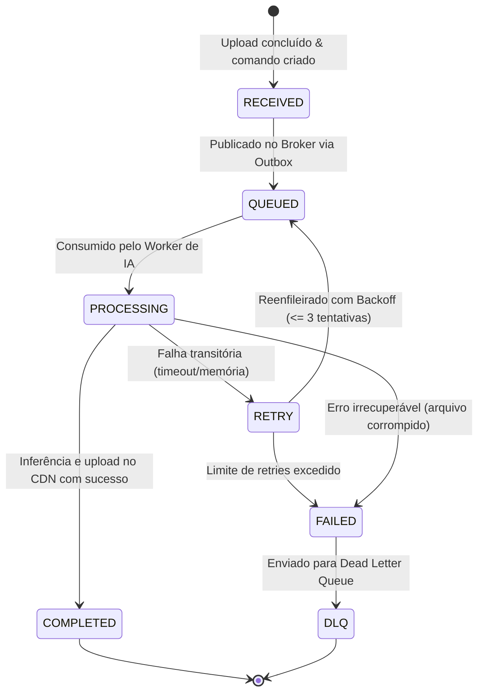

# 2. Casos de Uso e Requisitos Funcionais de Backend

---

## 2.1 Visão Geral dos Casos de Uso (CU01 a CU10)

Os casos de uso da plataforma PixPro estabelecem os requisitos funcionais do sistema. Para o desenvolvimento do **backend**, cada caso de uso possui impactos diretos na modelagem de dados, nos endpoints de API, na emissão de eventos e no processamento assíncrono.

| Código | Nome do Caso de Uso | Ator Principal | Serviço Backend Responsável | Tipo de Operação |
| :---: | :--- | :--- | :--- | :---: |
| **CU01** | Cadastro de usuário | Usuário Anônimo | Auth Service | Síncrono (REST) |
| **CU02** | Login / Autenticação | Usuário Registrado | Auth Service | Síncrono (REST) |
| **CU03** | Upload / Carregamento de imagem | Usuário Registrado | Project & Asset Service / Storage | Híbrido (REST + Direct Storage) |
| **CU04** | Processamento personalizado de imagem | Usuário Registrado | Image Processing Service + Workers | Assíncrono (EDA / Broker) |
| **CU05** | Recebimento de notificações em tempo real | Usuário Registrado | Notification Service (WebSocket) | Reativo (WebSocket + AsyncAPI) |
| **CU06** | Visualização e download de resultados | Usuário Registrado | Project & Asset Service / CDN | Síncrono (REST + CDN URL) |
| **CU07** | Gerenciamento de projetos e categorias | Usuário Registrado | Project & Asset Service | Síncrono (REST) |
| **CU08** | Acesso ao histórico de processamento | Usuário Registrado | Project & Asset Service | Síncrono (CQRS Query) |
| **CU09** | Gerenciamento de contas e perfil | Usuário Registrado | Auth Service | Síncrono (REST) |
| **CU10** | Monitoramento de métricas e saúde | Administrador (Opcional) | Gateway / Observability | Síncrono (Métricas / Health) |

---

## 2.2 Detalhamento Técnico dos Casos de Uso de Backend

### CU01: Cadastro de Usuário
- **Ator:** Usuário Anônimo.
- **Objetivo:** Criar uma nova conta de acesso à plataforma com credenciais seguras.
- **Impacto no Backend:**
  - Validação estrita de formato de e-mail, força de senha e unicidade de cadastro no PostgreSQL.
  - Hashing criptográfico unidirecional de senhas com salt utilizando algoritmos modernos (BCrypt / Argon2).
  - Emissão do evento de domínio `UserRegisteredEvent` via Outbox Pattern para provisionamento automático do espaço inicial de trabalho no *Project Service*.

### CU02: Login e Autenticação
- **Ator:** Usuário Registrado.
- **Objetivo:** Autenticar a identidade do usuário e emitir credenciais de acesso seguro para consumo das APIs e WebSocket.
- **Impacto no Backend:**
  - Emissão de tokens de acesso JWT (JSON Web Tokens) assinados de curta duração e Refresh Tokens com rotação controlada.
  - Validação de credenciais e persistência de sessões revogadas ou tokens em lista de bloqueio no **Redis**.
  - O JWT transporta claims essenciais (`userId`, `email`, `roles`), permitindo validação descentralizada no API Gateway e nos microsserviços sem sobrecarregar o banco de dados.

### CU03: Upload / Carregamento de Imagem (Individual ou em Lote)
- **Ator:** Usuário Registrado.
- **Objetivo:** Enviar uma imagem ou lote de imagens para armazenamento seguro antes da aplicação dos algoritmos de IA.
- **Impacto no Backend:**
  - **Padrão de Upload Otimizado (Presigned URLs):** O cliente solicita ao backend uma URL de upload pré-assinada gerada pelo serviço de ativos, enviando o binário diretamente para o Storage/CDN. Isso evita que gigabytes de tráfego binário sobrecarreguem as threads do API Gateway.
  - Registro de metadados da imagem no PostgreSQL: identificador único (UUID), nome original, tamanho em bytes, MIME type, dimensões, checksum SHA-256 e associação ao ID do projeto/usuário.
  - Suporte a lotes: criação de uma entidade `BatchUpload` que agrupa múltiplos registros atômicos de imagens para rastreabilidade unificada.

### CU04: Disparo de Processamento Personalizado de Imagem
- **Ator:** Usuário Registrado.
- **Objetivo:** Solicitar a execução de um ou mais modelos de IA com parâmetros personalizados para uma imagem ou lote.
- **Impacto no Backend:**
  - **Comando CQRS (`SubmitProcessingJobCommand`):** A requisição HTTP REST valida o payload (modelo de IA escolhido, parâmetros de contraste, ruído, estilo ou detecção de classes).
  - Persistência imediata da tarefa de processamento no banco transacional com estado inicial `RECEIVED`.
  - Gravação do evento na tabela de **Outbox** na mesma transação atômica do banco.
  - Publicação da mensagem no Message Broker (RabbitMQ) na fila de processamento:
  - Resposta síncrona imediata com status `HTTP 202 Accepted` contendo o `jobId` e o endpoint para consulta de status.
  - Consumo pelos **AI Workers**, execução da inferência computacional, persistência da imagem resultante no Storage/CDN e publicação do evento de conclusão `JobCompletedEvent` no broker.

### CU05: Recebimento de Notificações em Tempo Real
- **Ator:** Usuário Registrado.
- **Objetivo:** Acompanhar dinamicamente o status e progresso do processamento de imagens sem necessidade de *polling* HTTP constante.
- **Impacto no Backend:**
  - O cliente estabelece uma conexão persistente **WebSocket** com o *Notification Service*, autenticando-se via handshake com o JWT.
  - O *Notification Service* escuta tópicos/filas de eventos de processamento do broker e faz o roteamento das mensagens para a conexão ativa do usuário correto utilizando o **Redis Pub/Sub** para clusters escaláveis de WebSocket.
  - Eventos padronizados emitidos: `job:queued`, `job:started`, `job:progress` (ex: 45%), `job:completed`, `job:failed`.

### CU06: Visualização e Download de Resultados
- **Ator:** Usuário Registrado.
- **Objetivo:** Acessar a imagem final processada, comparar com o original e realizar download seguro ou compartilhamento.
- **Impacto no Backend:**
  - Geração de URLs temporárias assinadas e protegidas via CDN/Storage com expiração definida (ex: link válido por 15 minutos).
  - Controle de autorização: apenas o proprietário do projeto (ou quem possuir token de link compartilhado) pode gerar a URL assinada de download.
  - Registro de estatísticas de download e métricas de consumo de storage.

### CU07: Gerenciamento de Projetos e Categorias
- **Ator:** Usuário Registrado.
- **Objetivo:** Organizar imagens e processamentos em pastas, categorias temáticas e tags.
- **Impacto no Backend:**
  - Operações transacionais RESTful (CRUD) isoladas no *Project & Asset Service*.
  - Garantia de isolamento multi-tenant lógico: todas as consultas filtram obrigatoriamente pelo `user_id` extraído do token JWT autenticado.
  - Deleção em cascata lógica (*soft delete*) ou remoção controlada de ativos vinculados.

### CU08: Acesso ao Histórico de Processamento
- **Ator:** Usuário Registrado.
- **Objetivo:** Consultar execuções passadas, visualizar parâmetros utilizados, logs de auditoria e reprocessar imagens se desejado.
- **Impacto no Backend:**
  - Implementação de **Consultas CQRS (Read Projections):** Tabela de leitura desnormalizada e indexada por `user_id`, `created_at` e `status` para paginação veloz e buscas por filtros sem onerar as tabelas transacionais de escrita.
  - Endpoint de Reprocessamento (`POST /jobs/{id}/reprocess`): reutiliza os parâmetros gravados no histórico e dispara um novo comando de processamento no broker.

### CU09: Gerenciamento de Contas e Perfil
- **Ator:** Usuário Registrado.
- **Objetivo:** Atualização de perfil, redefinição de senhas, preferências de notificação e exclusão de conta.
- **Impacto no Backend:**
  - Emissão de evento de exclusão `UserDeletedEvent`: garante a limpeza de dados e anonimização de registros em conformidade com as diretrizes de privacidade e LGPD/GDPR.

### CU10: Monitoramento de Métricas e Integridade (Opcional / Admin)
- **Ator:** Administrador do Sistema.
- **Objetivo:** Visualizar volumetria do sistema, latência de inferência, tamanho de filas no RabbitMQ e saúde geral dos nós.
- **Impacto no Backend:**
  - Exportação de métricas padronizadas nos microsserviços via endpoints `/metrics` (formato Prometheus) e endpoints de `/health` e `/ready` (Kubernetes/Docker liveness checks).
  - Monitoramento da taxa de mensagens processadas por segundo (MPS) e do tempo médio de execução dos modelos de IA.

---

## 2.3 Máquina de Estados do Processamento de Imagens

O ciclo de vida de uma solicitação de processamento é governado por uma máquina de estados finita estrita, garantindo auditabilidade e consistência:

### Descrição dos Estados:
1. **`RECEIVED`:** A requisição foi validada e o registro do job foi criado no banco transacional com metadados.
2. **`QUEUED`:** O evento/mensagem foi despachado para a fila do RabbitMQ e aguarda um nó de execução disponível.
3. **`PROCESSING`:** O worker retirou a mensagem da fila, baixou a imagem do storage e está executando a inferência do modelo de IA selecionado.
4. **`COMPLETED`:** O resultado foi gerado, persistido no Storage/CDN, URLs atualizadas e notificação enviada.
5. **`RETRY`:** Falhas de rede ou recursos computacionais transitórios ativam mecanismo de repetição com backoff exponencial.
6. **`FAILED` / `DLQ`:** Em falha definitiva, o status é registrado para o usuário e o payload é enviado para análise na Dead Letter Queue.
