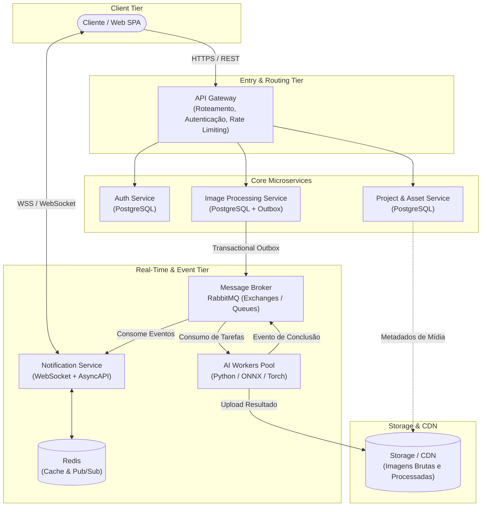
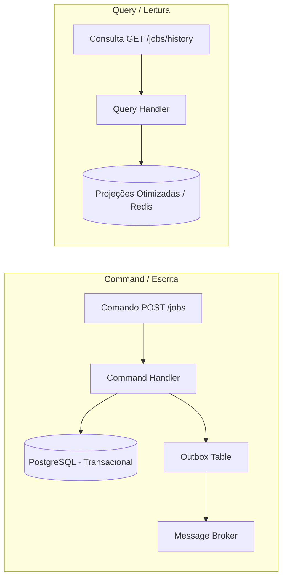
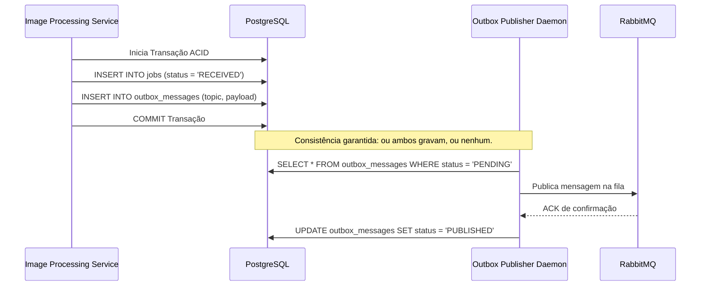

# 3. Arquitetura e Requisitos Técnicos de Backend

---

## 3.1 Visão Geral da Arquitetura Distribuída

O backend do **PixPro** é fundamentado em uma **Arquitetura Orientada a Eventos (EDA)** com decomposição em microsserviços especializados, orientada pelo isolamento de responsabilidades de domínio e pela separação entre operações de escrita e leitura (**CQRS**).



---

## 3.2 Padrões e Práticas Arquiteturais Aplicadas

### 1. Arquitetura Orientada a Eventos (EDA - Event-Driven Architecture)
- **Desacoplamento Temporal e Espacial:** Os serviços emissores (como o serviço de processamento) não precisam que os executores ou notificadores estejam disponíveis no milissegundo exato da emissão.
- **Topologia de Mensageria:**
  - **Exchanges no RabbitMQ:** Uso de `Topic Exchanges` ou `Direct Exchanges` categorizadas por tipo de domínio (`pixpro.events`, `pixpro.jobs`).
  - **Filas de Trabalho (Work Queues):** Fila `image.processing.v1` com distribuição balanceada (*Round-Robin*) entre os múltiplos nós de workers de IA.
  - **Dead Letter Exchange (DLX):** Roteamento automático de mensagens com falha irreversível para a fila `image.processing.dlq`.

### 2. Padrão CQRS (Command Query Responsibility Segregation)
O processamento de imagens e o acesso a históricos possuem perfis de carga e modelos de dados radicalmente diferentes:



- **Commands (Escrita):** Foco em validação de regras de negócio, consistência forte, emissão de tarefas e gravação transacional.
- **Queries (Leitura):** Foco em alto desempenho, consultas desnormalizadas, paginação em listas de histórico e caches com **Redis**.
- **Event Sourcing:** Manutenção da sequência imutável de eventos (`JobCreated`, `ProcessingStarted`, `FilterApplied`, `JobCompleted`), permitindo auditoria completa e reidratação de estados do processamento.

### 3. Padrão Transacional Outbox (Transactional Outbox Pattern)
Para resolver o problema clássico de *Dual-Write* (onde uma gravação no banco de dados é bem-sucedida, mas a publicação subsequente no broker de mensagens falha por queda de rede), adota-se o **Outbox Pattern**:



### 4. Padrões de Comunicação em Tempo Real e Especificação AsyncAPI
Para que o usuário receba atualizações instantâneas a cada mudança de estado sem polling excessivo:
- **WebSocket Protocol (WSS):** Conexão persistente de baixa latência e baixo overhead de headers HTTP.
- **Autenticação no Handshake:** Validação do token JWT no momento do handshake HTTP de upgrade para WebSocket.
- **Redis Pub/Sub como Broker de WebSocket:** Permite que múltiplos contêineres do serviço de notificações entreguem mensagens a clientes conectados em qualquer réplica.
- **AsyncAPI 2.x/3.x Specification:** Todas as mensagens, canais e tópicos de WebSocket e RabbitMQ são formalmente documentados sob a especificação [AsyncAPI](https://www.asyncapi.com/).

---

## 3.3 Estratégias de Resiliência e Tolerância a Falhas

Sistemas distribuídos operam sob a premissa de que componentes individuais falharão. O backend do PixPro implementa as seguintes proteções:

| Mecanismo | Aplicação no PixPro | Benefício |
| :--- | :--- | :--- |
| **Idempotência de Consumidores** | Workers gravam e verificam chave de idempotência (`jobId`) antes da inferência. | Evita reprocessar ou duplicar imagens caso uma mensagem seja reenviada pelo broker. |
| **Retry com Backoff Exponencial** | Falhas transitórias realizam até 3 repetições com intervalo crescente ($2^n \times base$). | Evita sobrecarga contínua de workers em caso de instabilidade pontual. |
| **Dead Letter Queue (DLQ)** | Mensagens que falham após o esgotamento de retries são roteadas para uma fila morta. | Isola mensagens corrompidas e impede o travamento (*head-of-line blocking*) da fila principal. |
| **Circuit Breaker** | Interrupção imediata de chamadas a serviços externos caso a taxa de erro ultrapasse 50%. | Previne efeito cascata de falhas entre microsserviços. |
| **Health Checks / Observabilidade** | Endpoints `/health/live` e `/health/ready` em todos os contêineres. | O orquestrador reinicia instâncias degradadas automaticamente. |

---

## 3.4 Persistência, Cache e Armazenamento Desacoplado

```text
┌─────────────────────────────────────────────────────────────┐
│                       PERSISTÊNCIA                          │
├───────────────────────┬─────────────────────────────────────┤
│ PostgreSQL 16         │ Armazenamento relacional ACID       │
│                       │ (Usuários, Projetos, Metadados,     │
│                       │ Tabela de Outbox, Histórico)        │
├───────────────────────┼─────────────────────────────────────┤
│ Redis 7               │ Caching de leitura, Rate Limiting,  │
│                       │ Revogação de JWTs e Pub/Sub WebSocket│
├───────────────────────┼─────────────────────────────────────┤
│ Storage / CDN         │ Armazenamento físico de binários    │
│ (S3 / MinIO / CDN)    │ de alta performance com URLs        │
│                       │ assinadas e seguras                 │
└───────────────────────┴─────────────────────────────────────┘
```

> **Diretriz de Isolamento de Dados:** Cada microsserviço possui seu próprio schema/banco de dados isolado no PostgreSQL. **Nenhum serviço acessa diretamente tabelas de outro serviço.** A comunicação entre fronteiras de domínio ocorre estritamente via APIs ou eventos.
