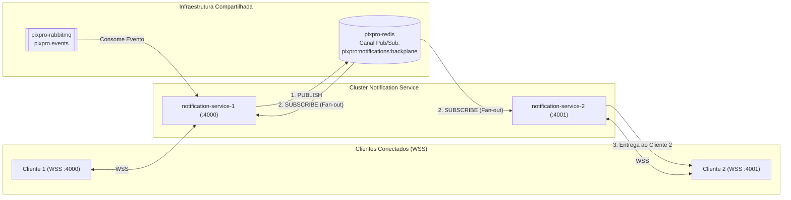

# Escalonamento Horizontal do Hub de Notificações (Redis Backplane & Reconexão Automática)

## 1. Visão Geral da Arquitetura

Para permitir que o `notification-service` opere com múltiplas instâncias concorrentes sem perda de notificações em tempo real (WebSocket/WSS), implementamos o **Redis Pub/Sub como Backplane de comunicação compartilhada** através do canal global `pixpro:notifications:backplane`.



### Componentes Implementados
- **[redisBackplane.js](file:///c:/Users/rhuan/Jala/DS5/Capstone/backend/services/notification-service/src/services/redisBackplane.js)**: Gerencia a assinatura (`SUBSCRIBE`) via cliente Redis duplicado (`createRedisSubscriber()`) e a publicação (`PUBLISH`) de envelopes globais contendo `eventId`, `originInstance`, `targetUserId`, `broadcast` e `payload`.
- **[docker-compose.yml](file:///c:/Users/rhuan/Jala/DS5/Capstone/infrastructure/docker-compose.yml)**: Configurado com duas instâncias concorrentes do hub:
  - `pixpro-notification-service-1` (`INSTANCE_ID=notification-service-1`, porta `4000`)
  - `pixpro-notification-service-2` (`INSTANCE_ID=notification-service-2`, porta `4001`)
- **[ws-client-reconnect.js](file:///c:/Users/rhuan/Jala/DS5/Capstone/backend/services/notification-service/scripts/ws-client-reconnect.js)** e **[notificationSocket.ts](file:///c:/Users/rhuan/Jala/DS5/Capstone/frontend/src/services/notificationSocket.ts)**: Clientes WebSocket resilientes com reconexão automática (*Exponential Backoff*) e *failover* automático entre as instâncias (`wss://localhost:4000` <-> `wss://localhost:4001`).

---

## 2. Roteiro Passo a Passo para Execução e Capturas de Tela

### Passo 1 — Subir o Redis e as Duas Instâncias do Notification Hub
Na raiz do repositório, execute:

```powershell
cd infrastructure
docker compose up -d --build redis rabbitmq image-processing-service notification-service-1 notification-service-2
```

> **Captura de Tela 1 (Containers Ativos):**
> ```powershell
> docker ps --filter "name=pixpro-notification" --filter "name=pixpro-redis"
> ```

---

### Passo 2 — Monitorar o Canal Pub/Sub no Redis (Terminal 1)
Abra um terminal exclusivo para monitorar em tempo real tudo o que passa pelo Redis Backplane:

```powershell
docker exec -it pixpro-redis redis-cli -a dev-redis-password MONITOR
```
*(Ou, para escutar apenas o canal do backplane: `docker exec -it pixpro-redis redis-cli -a dev-redis-password SUBSCRIBE pixpro:notifications:backplane`)*

---

### Passo 3 — Monitorar os Logs das Duas Instâncias do Hub (Terminal 2)
Abra um segundo terminal para exibir os logs combinados da Instância 1 e da Instância 2:

```powershell
docker logs -f pixpro-notification-service-1
```
E em outro painel/terminal:
```powershell
docker logs -f pixpro-notification-service-2
```

---

### Passo 4 — Validar a Comunicação Cruzada via Redis Backplane (Terminal 3)
Execute o script automatizado que conecta o **Cliente 1 na Instância 1 (`:4000`)** e o **Cliente 2 na Instância 2 (`:4001`)**, publica uma mensagem na Instância 1 e comprova a recepção no Cliente 2 através do Redis Backplane:

```powershell
npm --prefix backend/services/notification-service run test:cross-instance
```

> **Captura de Tela 2 (Evidência de Comunicação Cruzada):**
> - **No Terminal 3:** Mostra o Cliente 2 (conectado na porta `4001` / `notification-service-2`) recebendo o JSON com `"originInstance": "notification-service-1"` e `"deliveredByInstance": "notification-service-2"`.
> - **No Terminal 1 (`pixpro-redis`):** Mostra o comando `PUBLISH "pixpro:notifications:backplane"`.
> - **No Terminal 2 (`docker logs`):** Mostra `[Redis Backplane][notification-service-1] Evento publicado` e `[Redis Backplane][notification-service-2] Mensagem recebida no canal 'pixpro:notifications:backplane'`.

---

### Passo 5 — Simular Queda Repentina (`docker kill`) e Reconexão Automática (Terminal 3 e 4)

1. No **Terminal 3**, inicie o cliente resiliente (ele se conectará inicialmente na **Instância 1 - `wss://localhost:4000`** e também imprimirá o comando `wscat` caso queira testar manualmente):
   ```powershell
   npm --prefix backend/services/notification-service run test:reconnect
   ```
2. No **Terminal 4**, simule a queda abrupta (`kill`) da **Instância 1**:
   ```powershell
   docker kill pixpro-notification-service-1
   ```
3. Observe imediatamente no **Terminal 3** a detecção da queda e a **reconexão automática (failover)** para a **Instância 2 (`wss://localhost:4001`)**:
   ```text
   [Cliente WSS] Conexão encerrada com wss://localhost:4000 (code=1006, reason=queda abrupta / container kill).
   [Reconexão Automática] Agendando reconexão #1 para wss://localhost:4001 em 1000ms...
   [Cliente WSS] Conectando em wss://localhost:4001 (tentativa #1)...
   [Cliente WSS] CONECTADO com sucesso ao hub: wss://localhost:4001
   ```

> **Captura de Tela 3 (Evidência de Queda e Reconexão Automática):**
> - Tire print do **Terminal 3** mostrando a queda da conexão com `wss://localhost:4000` após o `docker kill` e a reconexão automática bem-sucedida em `wss://localhost:4001` (`notification-service-2`).
> - Para religar a Instância 1 depois do print: `docker start pixpro-notification-service-1`.
